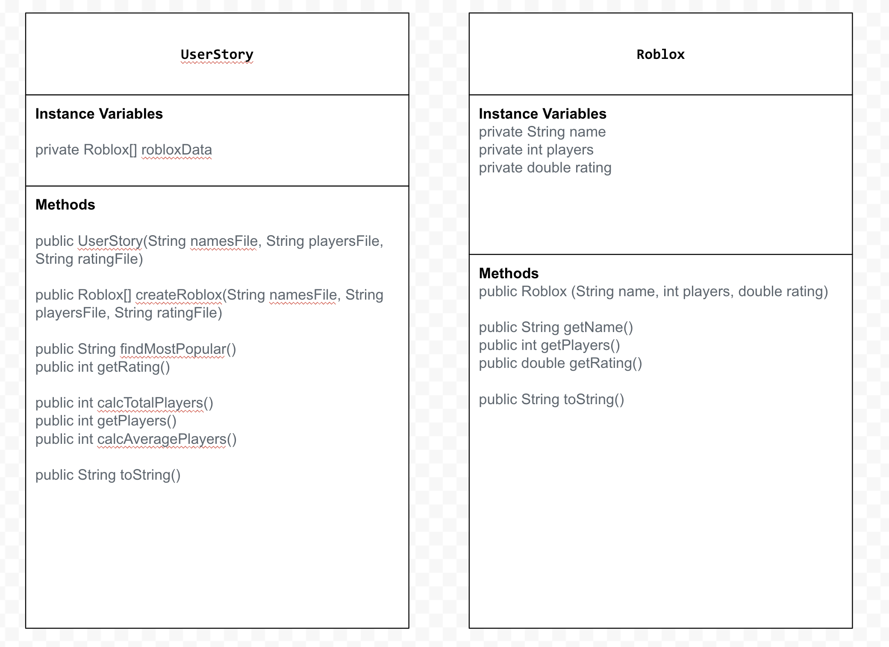

# Unit 3 - Data for Social Good Project

## Introduction

Software engineers develop programs to work with data and provide information to a user. Each user has different needs based on the information they are looking for from data. Your goal is to create a data analysis program for your user that stores and analyzes data to provide the information they need.

## Requirements

Use your knowledge of object-oriented programming, one-dimensional (1D) arrays, and algorithms to create your data analysis program:
- **Write a class** – Write a class to represent your user or business and store and analyze their data with no-argument and parameterized constructors.
- **Create at least two 1D arrays** – Create at least two 1D arrays to store the data that your user needs information about.
- **Write a method** – Write a method that finds or manipulates the elements in a 1D array to provide the information your user needs.
- **Implement a toString() method** – Write a toString() method that returns general information about the data (for example, number of values in the dataset).
- **Document your code** – Use comments to explain the purpose of the methods and code segments and note any preconditions and postconditions.

## User Story 

Include your User Story you analyzed for your project here. Your User Story should have the following format: 

> As a Roblox enthusiast,   
> I want to analyze Roblox data,   
> so that I can find the best game to play.

## Dataset 

Include a hyperlink to the source of your dataset used for this project. Additionally, provide a short description of each column used from the dataset, and the data type. 

Example: 

Dataset: https://www.kaggle.com/datasets/biggiefats/roblox-games-dataset/data
- **Name** (String) - name of the country 
- **Players** (int) - number of players in the game 
- **Rating** (double) - rating of the game

## UML Diagram 

Put an image of your UML Diagram here. Upload the image of your UML Diagram to your repository, then use the Markdown syntax to insert your image here. Make sure your image file name is one work, otherwise it might not properly get displayed on this README. 

 

## Description 

Write a description of your project here. In your description, include as many vocab words from our class to explain your User Story, the chosen dataset and how your project addressed that users goals. If your project used the Scanner class for user input, explain how the user will interact with your project.

My project is designed to help Roblox enthusiasts analyze data about different Roblox games to determine which game would be the best to play. Using a dataset containing each game's name, number of active players, and rating, I created two classes: Roblox and UserStory. The Roblox class uses instance variables to store each game's information and a parameterized constructor to initialize the attributes of each object. It also includes accessor methods to retrieve the name, number of players, and rating, as well as a toString() method to display each game's information. The UserStory class uses three 1D arrays to store the data from separate text files and an array of Roblox objects to organize the information. Through iteration and conditional statements, my findMostPopular() method uses a search algorithm to compare game ratings and identify the game with the highest rating. Additionally, my calcTotalPlayers() and calcAveragePlayers() methods calculate the total and average number of active players across all games. Finally, the toString() method in the UserStory class provides a readable summary of the dataset by displaying each game's information. Overall, my program uses object-oriented programming, arrays, constructors, methods, and algorithms to organize and analyze Roblox data, allowing users to make more informed decisions about which game they might enjoy playing.
